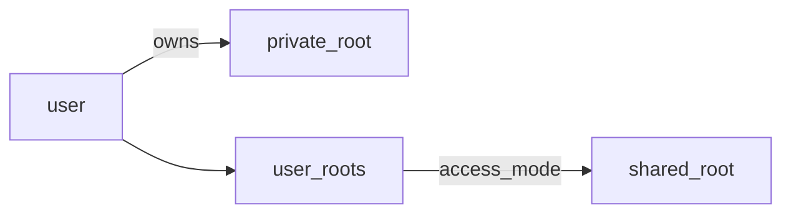
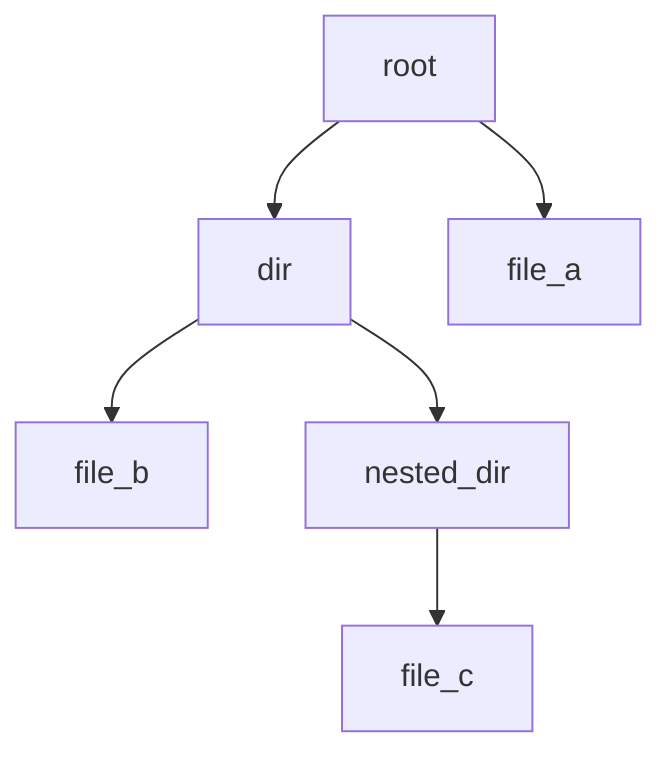
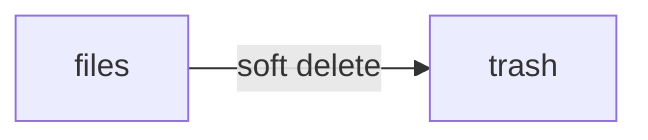
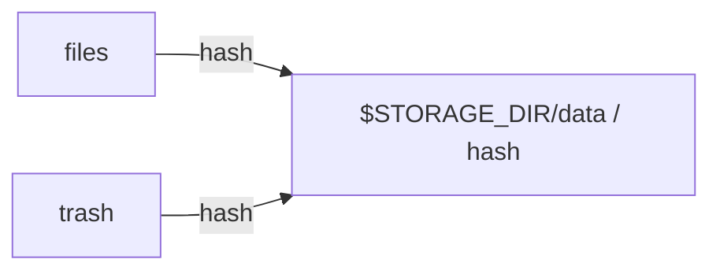

# Nimbus

Nimbus is a self-hosted file sharing application.

## Table of contents

- [Development disclaimer (AI LMAO)](#development-disclaimer-ai-lmao)
- [Development](#development)
  - [Quick start](#quick-start)
  - [Architecture](#architecture)
    - [Data models](#data-models)
    - [File BLOBs](#file-blobs)
    - [Clients](#clients)
- [Releases](#releases)
  - [nimbus-server](#nimbus-server)
  - [Nimbus Tauri app](#nimbus-tauri-app)

## Development disclaimer (AI LMAO)

Nimbus is made with AI tooling. That being said, this document, and all documentation
regarding the self hosting of Nimbus is written by a human being, i.e. I, `biblius`.

I reviewed all code in `server`, the business logic is \*mostly hand written and
AI was used to implement the plumbing (wiring routes, services to repos, boilerplate).
Most of the code in `client` was AI generated;
Connecting the server API is mostly just duplicating the DTOs
and writing out requests in `NimbusClient`. Page and component JS was \*\*mostly reviewed.
The main component `FileBrowser`, the pages, the admin UI components, and the
preview components were reviewed, mostly focusing on the JS parts because I
am shit at component layout and design anyway.

This project was not vibe coded. I've created Nimbus because I intend to use it.

The goal is to make a fully featured file hosting application that is simple to
set up and only needs a single binary, with additional infrastructure if desired.
Nimbus does not have contacts, calendars, AI worfklows for micro-categorization,
or Doom - it is just a file hosting application.

Nimbus is not E N T E R P R I S E and is focused toward smaller groups of people
that need a fast and reliable file sharing system without too much setup.

Anyway, that's enough disclaiming, let's go wild and host files!

---

\* meaning if the AI did good and there's no reason to change anything, then it was technically
still generated by AI :-)

\*\* meaning the `ui` components are all AI generated (with "make it PRO" of course)
because it boils down to the same thing like using something like `shadcn-svelte`
for codegen, but is already adjusted to fit the rest of the app.

---

## Development

Nimbus is made with Rust and Svelte.

### Quick start

1. You will need:
   - Rust for building the server
   - npm for building (and developing) the client
   - docker (with docker-compose) for setting up the infra
   - sqlx (for running migrations, `cargo install sqlx-cli`)

2. Copy `example.env` to `.env`.

```bash
cp example.env .env
```

3. Source the necessary environment variables and initialize
   infrastructure (Postgres, Valkey) with `docker-compose`.

```bash
source setup.sh [-h | -r | -c]
```

4. Start the server.

```bash
RUST_LOG=info,sqlx=off,nimbus_server=debug cargo run
```

It should be available at `http://localhost:42069`.

5. Start the Vite development server.

```bash
npm run dev -w @nimbus/web
```

It should be available at `http://localhost:5173`.

69420. Host files and bankrupt GDrive.

### Architecture

`nimbus-server` is the main binary powering Nimbus. It serves the web frontend and the API used
to interact with Nimbus. Depending on the build features, Nimbus can run with either SQLite or
Postgres as its database backend. It can also run with either Valkey or a HashMap as its cache
backend which is controlled by the presence of an existing `VALKEY_URL` env variable.

The project is divided into 2 parts; The `server` directory contains `nimbus-server`, the core of Nimbus, and
the `client` directory contains clients who talk to `nimbus-server`.

#### Data models

Every `user` in Nimbus gets assigned a private `root` directory (or folder as it is named in the client).

A root in Nimbus is the primary entity which to which users get assigned for creating or accessing `files`.
A root can be either private or shared. A private root can only be accessed by its user and
administrators. A user can only have one private root. A private root is indicated by the
presence of its `owner` field. Users always have full access to their private root and their
roots are always deleted along with them.

A shared root is a root that can be accessed by multiple users. Shared root membership
is defined in `user_roots` which also stores the assignment and its access control bitflag.



In essence, you can think of a root directory as the root of a virtual file system.

Every file a user uploads to `files` is therefore tied to a root. A file in Nimbus is a record in
the `files` table. A file entry's kind can either be file or directory. A file can reference other
files with its `parent` field. When a file has no `parent` relation, it is considered to be in
the top level of the root. A file with a parent field is considered to be nested in that directory,
the `parent` relation can never point to a file of kind file.



Soft deleted files are files moved from `files` to `trash`. This table is essentially a copy of
`files`, but stores files removed by users from a root. Trashed files are also taken into
account when counting hashes for new/deleting BLOBs.



#### File BLOBs

File BLOBs in Nimbus are stored to `$STORAGE_DIR/data`. BLOBs are stored with their hash
as the name on the file system. Nimbus dedupes file BLOBs by hash, i.e. for every new BLOB it always checks
whether a BLOB with the same hash exists prior to writing and stores it only when it doesn't exist.
Likewise, BLOBs are deleted only when there are no more files pointing to it.



Nimbus uses tokio `select!` loops to process background tasks. Image/video thumbnail processing
and expired trash deletion sweeps are implemented as background processes.

Thumbnail BLOBs follow the same principles as those of `files` (and `trash`).

#### Clients

Clients are further divided into the `web` and `app` directories, intended for web and native devices respectively.
The `shared` directory contains the code used by both directories - a SPA shell. `web` is built with Vite and
its `dist` is embedded into `nimbus-server` at compile time. `app` is a Tauri app built with cargo.

## Releases

### nimbus-server

Release targets:

- `x86_64-unkown-linux-gnu`
- `aarch64-unknown-linux-gnu`

Every release will have 2 variants built with `sqlite` and `postgres` as the database engine.

### Nimbus Tauri app

Release targets:

- TODO
